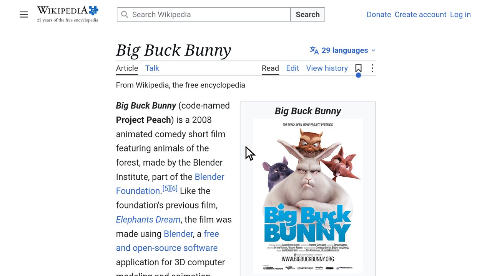
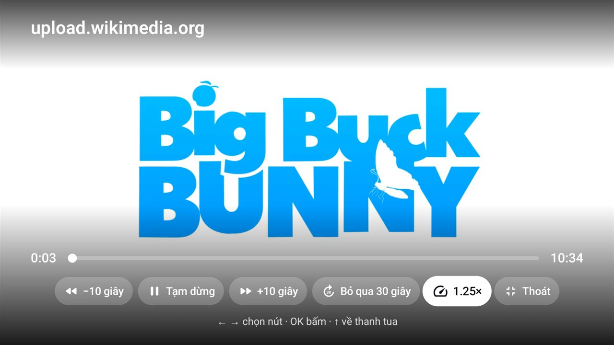
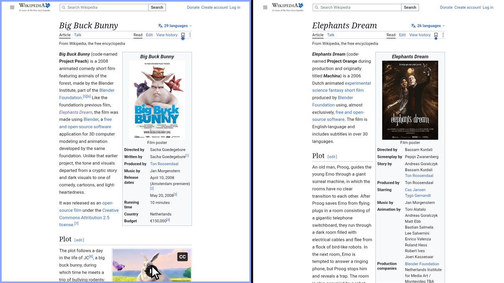
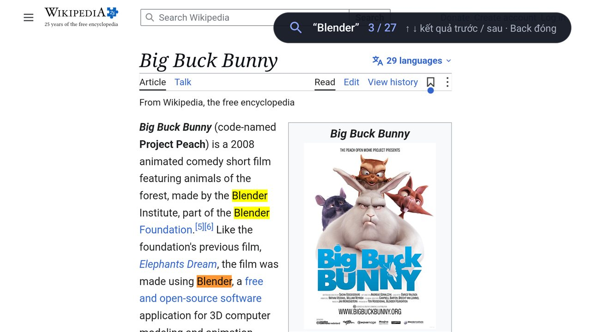
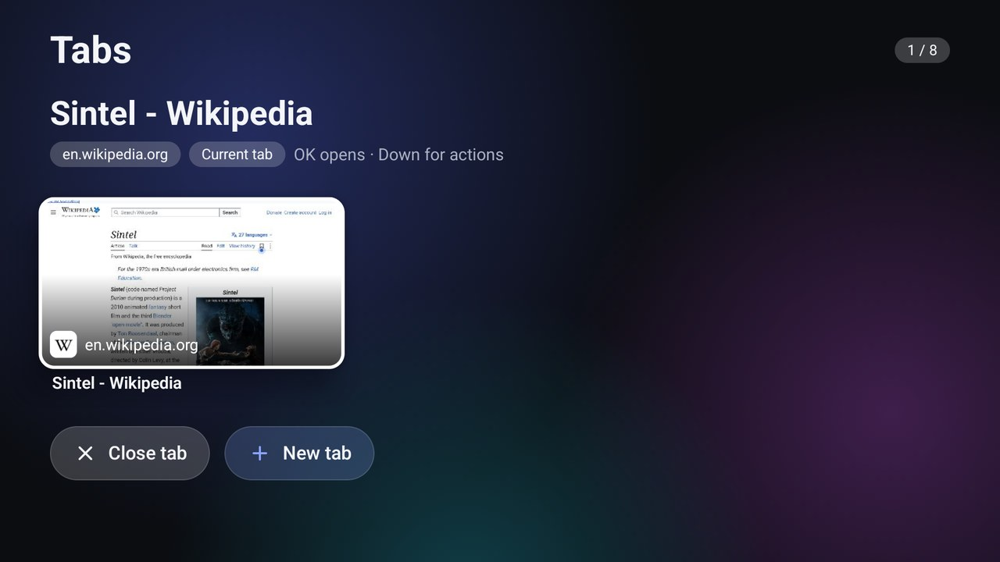
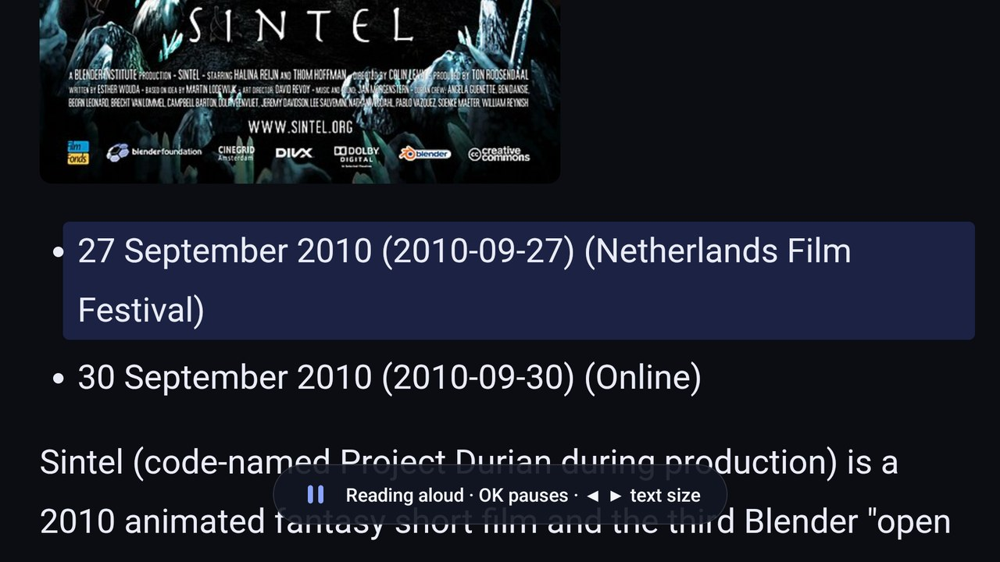
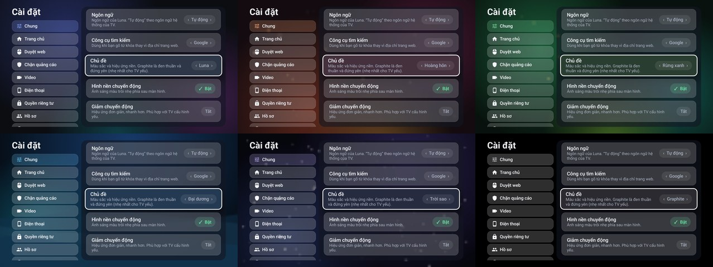
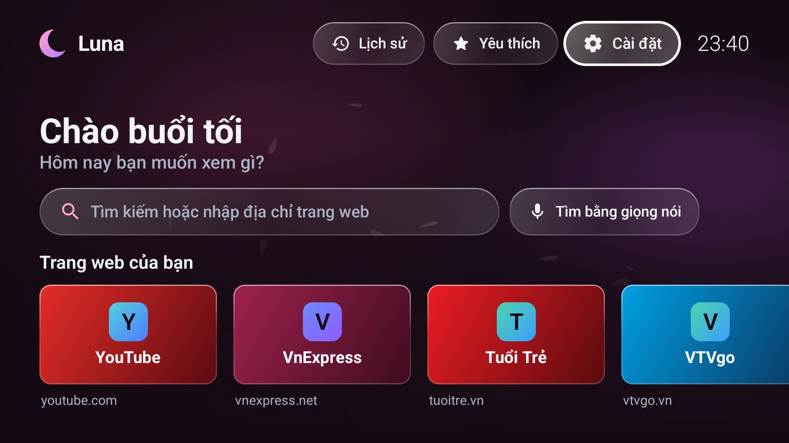
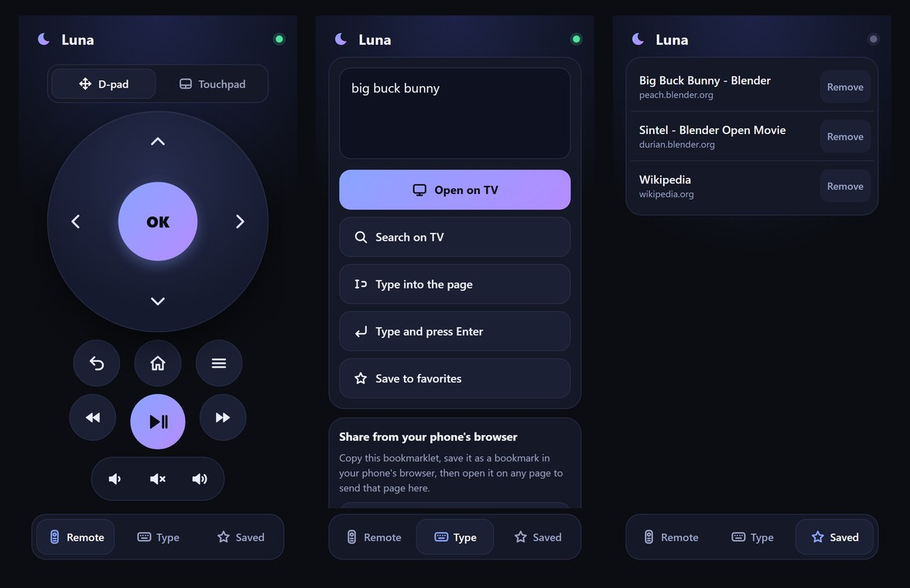

<div align="center">


# Luna Browser

### The web browser built for your TV remote

Steer the web with the D-pad, watch from the sofa, skip the ads — on any Android TV or Google TV.

[](https://github.com/newhalo/luna-browser/actions/workflows/build.yml)
[](https://github.com/newhalo/luna-browser/releases/latest)
[](https://github.com/newhalo/luna-browser/releases)
[](LICENSE)
-3DDC84?logo=android&logoColor=white)


[**⬇ Download the APK**](https://github.com/newhalo/luna-browser/releases/latest) ·
[Features](#features) ·
[Screenshots](docs/SCREENSHOTS.md) ·
[Install](#install) ·
[Phone remote](#phone-remote) ·
[Docs](#documentation) ·
[Contribute](#contributing)

<br>


</div>

<br>

Most Android TV browsers are phone browsers stretched onto a big screen. **Luna starts from the remote instead**: an
on-screen pointer that jumps to links, video controls made for **Play / Pause / ← / →**, a built-in ad and pop-up blocker,
and a home screen that feels like a streaming app. No accounts, no tracking, MIT licensed.

<table>
<tr>
<td width="33%" valign="top">

**🎯 Made for the remote**<br>
A short arrow press jumps to the next link or button; hold to glide. Every screen works with the D-pad alone.

</td>
<td width="33%" valign="top">

**🎬 Video first**<br>
Fullscreen controls for any HTML5 video, even inside another site's player iframe: seek, skip 30 s, speed, 0–9 to jump.

</td>
<td width="33%" valign="top">

**🛡️ Ads and pop-ups blocked**<br>
EasyList / ABPVN filters, pop-up and redirect guards, invisible overlays and "disable your ad blocker" nags removed.

</td>
</tr>
<tr>
<td valign="top">

**📱 Your phone as a remote**<br>
Scan a QR code: D-pad, touchpad, keyboard and favourites in your phone's browser. Nothing to install.

</td>
<td valign="top">

**👨‍👩‍👧 Profiles and private tabs**<br>
Up to five people plus a guest, each with their own history and sign-ins, optional PIN. Private tabs leave no trace.

</td>
<td valign="top">

**⚡ Light on weak TVs**<br>
0.6 s cold start and ~55 fps on a 32-bit MediaTek TV chip. Ten languages, seven themes.

</td>
</tr>
</table>

> [!NOTE]
> **Latest: [v0.10.3](https://github.com/newhalo/luna-browser/releases/latest).** New video controls (speed, skip 30 s,
> number keys jump like on YouTube), **split screen**, **find on page**, address suggestions, optional **dark pages**,
> hidden cookie banners and a count of what was blocked on each page. 0.9.3 tamed the *snapping pointer*, 0.9.0 brought
> *private tabs*. Every release: [CHANGELOG.md](CHANGELOG.md).

## Features

### A pointer that finds the link for you

<table>
<tr>
<td width="55%"></td>
<td valign="top">

A **short press** of an arrow nudges the pointer a few pixels, so small things like a video's seek bar can be reached
by hand. **Hold** an arrow to jump from link to link in that direction (repeating while it is down, nothing farther than
a zone around the pointer, scrolling when there is none nearby, also sideways for rows of episodes). On a seek bar, holding
Left / Right slides along it; on top of a video or player frame, holding moves the pointer freely (its controls are
often out of reach for Luna). **OK** clicks. Number keys jump a video in the page to 0–90 %.

Prefer the classic way? Hold **OK** for link-to-link focus, or switch snapping off in Settings.

</td>
</tr>
</table>

### Video controls that understand a remote

<table>
<tr>
<td valign="top">

Any HTML5 video gets big, readable fullscreen controls, **even when the player sits in an iframe from another domain**,
as on many video sites. Hold **←** / **→** to seek: the jump grows (10 s → 30 s → 60 s), is previewed on the bar and sent
as **one** seek, so the stream doesn't reload at every step.

**↓** opens a row of buttons: −10 s, play / pause, +10 s, **skip 30 s**, **speed** (0.5× to 2×, kept for the next
episode) and exit. The **number keys** jump like on YouTube: **5** is halfway, **0** the start. **CH+ / CH−** skip 30 s.

**Continue where you left off:** videos of three minutes or more remember their position, fullscreen or inline, and
Home shows them with a progress bar.

</td>
<td width="55%"></td>
</tr>
</table>

### Split screen and find on page

<table>
<tr>
<td width="50%"></td>
<td width="50%"></td>
</tr>
<tr>
<td valign="top"><b>Split screen</b> (toolbar <i>Split</i>): two tabs side by side, a video next to an article or two pages to compare. The framed half gets the keys; switch with the <b>blue</b> key, the toolbar, or by pushing the pointer across the middle.</td>
<td valign="top"><b>Find on page</b> (toolbar <i>Find</i>): type a word, then <b>↑ / ↓</b> step through the matches. Back closes.</td>
</tr>
</table>

### Tabs, reading mode and read aloud

<table>
<tr>
<td width="50%"></td>
<td width="50%"></td>
</tr>
<tr>
<td valign="top"><b>Up to 8 tabs</b> as 16:9 cards with a fresh screenshot of each page. Only the latest few stay alive, the rest are frozen to save memory, and tabs survive restarts.</td>
<td valign="top"><b>Reading mode</b> turns an article into large, clean text with a reading time. <b>OK reads it aloud</b> with the TV's voice and highlights the paragraph.</td>
</tr>
</table>

### Make it yours

<p align="center">

</p>

**Seven themes**, each with its own colours and gentle background motion: *Luna*, *Dusk* (embers), *Forest* (fireflies),
*Ocean* (waves), *Night sky* (stars), *Sakura* (drifting petals) and *Graphite* (pure black, nothing moves, the lightest on
weak TVs). Add the optional frosted **Glass look**, pick a thumbnail size for Home, and show History as a list or a grid.

<table>
<tr>
<td width="50%"></td>
<td width="50%"></td>
</tr>
<tr>
<td valign="top"><b>Sakura + Glass look:</b> translucent cards and buttons, petals behind.</td>
<td valign="top"><b>Profiles:</b> up to five people plus a guest, each with their own history, favourites, tabs and (on a recent web engine) sign-ins. A 4-digit PIN can lock a profile.</td>
</tr>
</table>

### Everything else

<details>
<summary><b>The full feature list</b> (click to expand)</summary>

<br>

**Browsing**
- Streaming-style **home screen**: animated background, a backdrop that follows the focused card, real thumbnails of
  what you opened, *continue watching*, your most-used sites, favourites, clock and **voice search**.
- Floating two-row **toolbar** (address with what was blocked on the page, Find, Split; Back, Forward, Refresh, Home, Tabs,
  Save, Read, pointer mode, This site, Settings), History, Favourites, clear error screens (offline, DNS, timeout, TLS).
- **Suggestions while typing** from your open tabs, favourites and history, matched without accents ("phim" finds
  "Phím"). Worked out on the TV: nothing you type is sent anywhere.
- **Dark pages** (off by default; *Settings → Browsing*, or per site): the web engine darkens pages that have no dark look of
  their own.
- Type a site without `www` or `https` and it still opens: Luna retries `www.`, plain http, or searches.
- **Per-site settings** (toolbar *Site*): desktop mode, text size, ad blocking, dark page and pointer mode for one site, plus
  **Report a problem** with a QR code that opens a pre-filled GitHub report.

**Privacy and safety**
- **Private tabs**: no history, video position, thumbnail or saved tab; own sign-ins (on a recent web engine) until the
  last private tab closes.
- **Ad, tracker and pop-up blocking** with Adblock Plus / uBlock Origin syntax, lists refreshed daily
  ([docs/ADBLOCK.md](docs/ADBLOCK.md)). The toolbar shows how much was blocked on the page.
- **Cookie banners hidden** without accepting anything (on by default, *Settings → Ad blocking*).
- No accounts, analytics or telemetry ([Privacy](#privacy)). Guest mode erases itself, even after a crash.

**Made for TV**
- Every control reachable with the D-pad, visible focus, safe-area margins, large type, *Reduce motion* setting.
- One APK for every CPU and resolution (720p to 4K); entry-level TVs get a lighter profile automatically
  ([docs/PERFORMANCE.md](docs/PERFORMANCE.md), [docs/COMPATIBILITY.md](docs/COMPATIBILITY.md)).
- **Speaks your language:** English, Tiếng Việt, Español, Français, Deutsch, Português, Русский, 日本語, 한국어, 中文.
  Follows the TV's language; change it in *Settings → General*.

</details>

More pictures (toolbar, settings, history, PIN pad, error screens…) in the **[screenshot gallery](docs/SCREENSHOTS.md)**.

## Install

You need an **Android TV / Google TV** with Android 8.0 or newer. Tested on a Xiaomi TV S Pro 65"; reports from other
TVs are welcome ([docs/COMPATIBILITY.md](docs/COMPATIBILITY.md)).

**Easiest, no computer:** install the **Downloader** app on the TV, open
`https://github.com/newhalo/luna-browser/releases/latest`, pick `luna-browser-vX.Y.Z.apk` and allow Downloader to install
apps once.

**With a computer (adb):** enable *Developer options → USB / network debugging* on the TV (*Settings → Device
Preferences → About*, press *Build* seven times), download the APK from the
[latest release](https://github.com/newhalo/luna-browser/releases/latest) (its SHA-256 is listed there), then:

```bash
adb connect <tv-ip>:5555
adb install -r luna-browser-vX.Y.Z.apk
```

Luna appears in the launcher as **Luna Browser**, in the TV's language (for example *Trình duyệt Luna* in Vietnamese,
*Navegador Luna* in Spanish). To update, install the newer APK the same way; your history and
favourites are kept. Store plans: [docs/PUBLISHING.md](docs/PUBLISHING.md).

> [!IMPORTANT]
> Official releases are signed with the project's private key, builds from source with the public development key, and
> Android won't install one over the other. Uninstall first (`adb uninstall com.luna.browser`; this clears Luna's data).

## Controls

| Key | On a web page | In fullscreen video |
|---|---|---|
| **D-pad** | short press: nudge the pointer a few pixels; hold: jump to the next nearby link or button that way, repeating (scrolls when there is none close by); **Up** at the very top opens the toolbar | **← / →** seek (hold to accelerate); **↓** the buttons (−10 s, play, +10 s, skip 30 s, speed, exit) |
| **0–9** | — | jump to 0–90 % of the video |
| **CH+ / CH−** | scroll the page | skip 30 s forward / back |
| **Blue** key | split screen: the other half gets the keys | — |
| **OK** | click | show controls, then play / pause |
| Hold **OK** | switch pointer ⇄ link-focus mode | — |
| **Menu** / **Info** | show / hide the toolbar | same |
| **Back** | close toolbar → find bar → previous page → Home → exit | leave the buttons → hide controls → leave fullscreen |
| Hold **Back** | open the toolbar (for remotes without Menu) | leave fullscreen, open toolbar |
| Play/Pause, ⏪ ⏩ | control the page's video | same |

Home, volume and power keys are never intercepted. Full map: [docs/DESIGN.md](docs/DESIGN.md#remote-map).

## Phone remote

<table>
<tr>
<td valign="top" width="40%">

Typing with a TV remote is slow, and not every remote has a Menu key. Open *Settings → Phone remote*, scan the QR code,
and your phone becomes a **remote**, a **touchpad**, a **keyboard** and your **favourites** list.

It is a web page served by the TV on your Wi-Fi: nothing to install, PIN-protected, LAN only, and listening only while
Luna is on screen.

Pairing, sharing a page from your phone and the safety rules: [docs/PHONE_REMOTE.md](docs/PHONE_REMOTE.md).

</td>
<td></td>
</tr>
</table>

## Privacy

Luna has no accounts, no analytics and no telemetry. The only network traffic besides the pages you open:

| Request | When | Why |
|---|---|---|
| Filter lists: EasyList (`easylist.to`) or, for Vietnamese, ABPVN (`raw.githubusercontent.com`, `abpvn.com`), plus Luna's own `luna.txt` from this repository (`raw.githubusercontent.com`) | first run, then daily | ad-blocking rules (each list can be switched off in Settings) |
| `api.github.com` (latest release) | once a day, only for builds **not** installed from a store | tells you a newer Luna exists; nothing is downloaded or installed (switch off in Settings → About) |
| Thumbnails (`i.ytimg.com` or the page's own `og:image`) | home / history cards | artwork for pages you visited |
| Incoming: your phone → the TV on port 8765 (LAN only, PIN-protected) | only while Luna is on screen and *Phone remote* is on | the phone remote |

History, favourites and thumbnails stay in the app's private storage on the TV; *Settings → Privacy* clears them.
Pages are rendered by the Android System WebView and get **no** JavaScript bridge to the app.

## Documentation

| | |
|---|---|
| [Architecture](docs/ARCHITECTURE.md) | how the app is put together: start here |
| [Design](docs/DESIGN.md) | TV UI rules, remote key map, themes |
| [Ad blocking](docs/ADBLOCK.md) | filter engine, lists, pop-up guard |
| [Performance](docs/PERFORMANCE.md) | budgets and measurements on real TVs |
| [Compatibility](docs/COMPATIBILITY.md) | supported TVs, known limits, reporting a device |
| [Localization](docs/LOCALIZATION.md) | adding or reviewing a language |
| [Phone remote](docs/PHONE_REMOTE.md) | pairing, sharing pages, security |
| [Releasing](docs/RELEASING.md) · [Publishing](docs/PUBLISHING.md) | release process, app stores |
| [Roadmap](docs/ROADMAP.md) · [Screenshots](docs/SCREENSHOTS.md) | what's next and what each release added; full gallery |

## Build from source

Requirements: **JDK 17** and the **Android SDK** (platform 34); Android Studio sets up both.

```bash
git clone https://github.com/newhalo/luna-browser.git
cd luna-browser
./gradlew :app:testDebugUnitTest :app:assembleDebug     # gradlew.bat on Windows
adb install -r app/build/outputs/apk/debug/app-debug.apk
```

Use `:app:assembleRelease` for the optimised build (R8 + baseline profiles), the one to run on a TV. Debug and release
builds from source share the public development key; see [docs/RELEASING.md](docs/RELEASING.md).

<details>
<summary><b>Project layout</b></summary>

```
app/src/main/java/com/luna/browser/
  MainActivity.kt, AppState.kt        entry point, navigation, global key handling, language
  browser/                            WebView controller (cursor, video, popups), PopupGuard
  data/                               Store (settings, history), AdBlocker, filter/ (list parser + engine), Resume (video positions)
  remote/                             PhoneRemote: the LAN web server + page behind "your phone as a remote"
  ui/                                 Compose screens, TV components, theme
app/src/main/res/values*/strings.xml  UI strings: English default + 9 translations
app/src/main/assets/filters/luna.txt  Luna's own filter rules (Adblock Plus syntax)
app/src/test/                         unit tests (filter engine, localisation, device compatibility, resume rules, phone remote)
tools/sitecheck/                      on-TV ad-blocking report (Chrome DevTools + adb)
tools/perf/                           on-TV frame timing
docs/                                 the documents listed above
```

</details>

## Roadmap

**Next**
- [ ] Native-speaker review of the translations, then more languages ([how](docs/LOCALIZATION.md)).
- [ ] Compatibility reports from more TVs and Android versions ([how](docs/COMPATIBILITY.md#reporting-a-device)).
- [ ] Read aloud: choose the voice and speed, and skip to the next / previous paragraph.
- [ ] Per-profile settings (search engine, language, home layout).
- [ ] Live thumbnails for tabs that are frozen.

**Later:** emulator-based UI tests for D-pad navigation · Gradle 9 and the newest Compose · a Google Play listing
([docs/PUBLISHING.md](docs/PUBLISHING.md)).

**Not planned:** a download manager (a TV browser is for watching) · DRM streaming services such as Netflix or Disney+
(a WebView can't provide the hardware DRM they need; use their own apps).

Full history: [docs/ROADMAP.md](docs/ROADMAP.md) and [CHANGELOG.md](CHANGELOG.md).

## Contributing

Pull requests are welcome! Please read [CONTRIBUTING.md](CONTRIBUTING.md) and the [Code of Conduct](CODE_OF_CONDUCT.md)
first.

- **A site still shows ads?** Use the *Ad / pop-up report* issue template (or *Site → Report a problem* on the TV); it is
  usually a one-line fix.
- **Speak one of the ten languages?** A review of the translations helps a lot ([how](docs/LOCALIZATION.md)).
- **Different TV?** A [compatibility report](docs/COMPATIBILITY.md#reporting-a-device) tells us what works.
- **Security issue?** See [SECURITY.md](SECURITY.md).
- **Using an AI coding assistant?** Point it at [AGENTS.md](AGENTS.md): the project context, rules and pitfalls.

If Luna makes your TV nicer to use, a ⭐ on GitHub helps others find it.

## Acknowledgements

[EasyList](https://easylist.to) and [ABPVN](https://abpvn.com) for the filter lists ·
[Jetpack Compose](https://developer.android.com/jetpack/compose) · [Coil](https://coil-kt.github.io/coil/) · the
Chromium / Android WebView team · the Blender Foundation for open movies that make great test footage. Full list:
[THIRD_PARTY_NOTICES.md](THIRD_PARTY_NOTICES.md).

## Disclaimer

Luna is a general-purpose browser. It does not host, index or distribute any content, and the ad blocker exists to
protect viewers from intrusive ads, trackers and malicious pop-ups. You are responsible for complying with the laws
and terms of service that apply to the sites you visit.

## License

[MIT](LICENSE) © 2026 Nguyen Anh Luan
