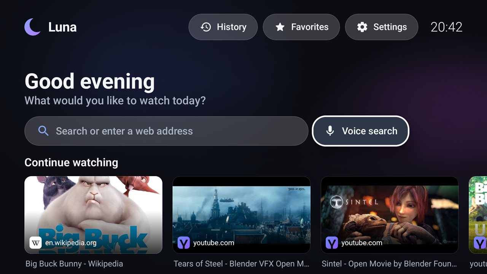
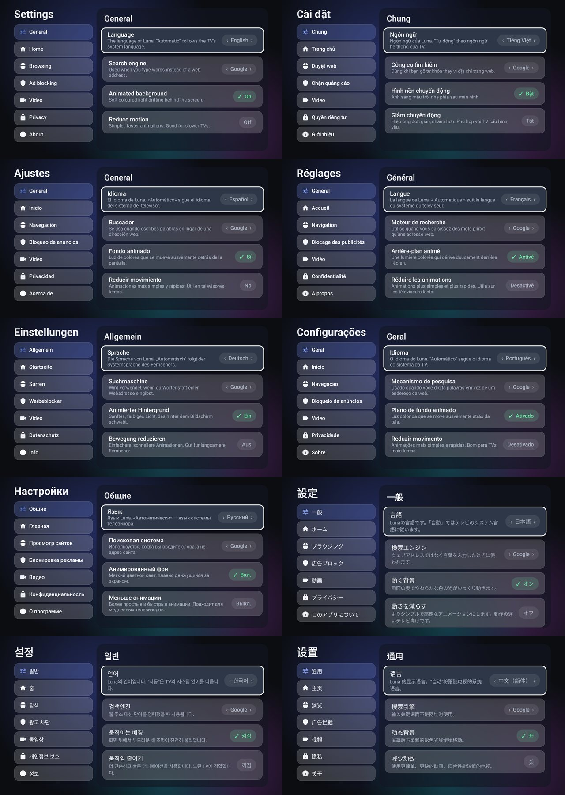

<div align="center">

# Luna Browser

**A web browser built for the living-room TV — designed for the remote, readable from the sofa, smooth on weak TV hardware.**

[](https://github.com/newhalo/luna-browser/actions/workflows/build.yml)
[](LICENSE)
-3DDC84?logo=android&logoColor=white)


</div>

Most Android TV browsers are phone browsers stretched onto a big screen. Luna starts from the remote instead:
an on-screen pointer you steer with the D-pad, one-press access to everything, video controls made for
**Play / Pause / Left / Right**, a built-in ad and pop-up blocker, and a home screen that feels like a streaming app.

> **Status:** early (0.x) but daily-driven on a real TV. The UI is available in **10 languages** and follows the TV's
> system language — see [docs/LOCALIZATION.md](docs/LOCALIZATION.md).

## Features

- **Streaming-style home screen** — animated background, a backdrop that follows the focused card, 16:9 cards with
  real thumbnails of the videos and pages you opened, "continue watching", your most-used sites, favourites,
  clock and voice search.
- **Virtual cursor** — accelerates while you hold an arrow, hides itself when idle, scrolls at the screen edge,
  clicks with **OK**. Hold **OK** to switch to link-to-link focus navigation.
- **Video first** — fullscreen controls for any HTML5 video, **even inside a player iframe from another domain**
  (where most film sites put it). Hold ← / → to seek: key repeats accumulate, accelerate (10 s → 30 s → 60 s) and
  are previewed on the progress bar, then sent as **one** seek, so the stream doesn't reload at every step.
- **Ad, tracker and pop-up blocking** — a standards-based filter engine (Adblock Plus / uBlock Origin syntax)
  with the community [EasyList](https://easylist.to) and [ABPVN](https://abpvn.com) lists refreshed daily, a built-in list, generic pop-up and
  redirect protection, removal of invisible click-catching overlays and "disable your ad blocker" nags.
  Details in [docs/ADBLOCK.md](docs/ADBLOCK.md).
- **Made for TV hardware** — 0.6 s cold start and ~55 fps on a 32-bit MediaTek TV SoC; see
  [docs/PERFORMANCE.md](docs/PERFORMANCE.md).
- **Remote-only UX** — every control reachable with the D-pad, visible focus, no touch-only UI, safe-area margins,
  large type, *Reduce motion* setting.
- Floating toolbar (Back, Forward, Refresh, Home, address, Save, pointer mode, Settings), History, Favourites,
  clear error screens (offline, DNS, timeout, TLS), settings in seven plain-language groups.
- **Speaks your language** — English, Tiếng Việt, Español, Français, Deutsch, Português, Русский, 日本語, 한국어, 中文.
  Follows the TV's system language automatically; switch any time in Settings → General → Language.
- **Private by design** — no accounts, analytics or telemetry. See [Privacy](#privacy).

## Screenshots

> Captured on a Xiaomi TV S Pro 65" (4K, Android 14). Sample content is the open-source Blender movie
> *Big Buck Bunny* and Wikipedia.



| | |
|:--|:--|
|  |  |
| **Hold → to seek:** target time and bar preview, one seek on release | **OK** shows controls; OK again plays / pauses |
|  |  |
| **Menu** opens the floating toolbar | The on-screen pointer; **OK** clicks |
|  |  |
| Language picker (Automatic follows the TV), search engine, background | Filter lists with rule counts and update dates |
|  |  |
| Pointer speed, desktop sites, page text size | Clear errors with one-press recovery |

### Ten languages, live

The UI follows the TV's system language; this is Settings in every translation (switching needs no restart):



## Install

You need an **Android TV / Google TV** (Android 8.0+, API 26) and the ability to sideload an APK. One APK runs on
any CPU architecture and any TV resolution (720p to 4K); entry-level TVs get a lighter profile automatically.
Details and known limits: [docs/COMPATIBILITY.md](docs/COMPATIBILITY.md). Tested so far on a Xiaomi TV S Pro 65"
— reports from other TVs are welcome.

1. Download `luna-browser-vX.Y.Z.apk` from the [Releases](https://github.com/newhalo/luna-browser/releases) page
   (or the `luna-browser-release` artifact of a CI run).
2. On the TV enable **Developer options → USB debugging / network debugging**
   (Settings → Device Preferences → About → press *Build* seven times).
3. From a computer on the same network:

   ```bash
   adb connect <tv-ip>:5555
   adb install -r luna-browser-vX.Y.Z.apk
   ```

   Accept the *Allow USB debugging?* prompt on the TV the first time. Without a computer you can use a
   "send files to TV" app and a file manager instead.

Luna appears in the TV launcher as **Luna Browser**.

## Controls

| Key | On a web page | In fullscreen video |
|---|---|---|
| D-pad | move the pointer; at the screen edge scroll; **Up** at the very top opens the toolbar | **← / →** seek (hold to accelerate) |
| **OK** | click | show controls, then play / pause |
| Hold **OK** | switch pointer ⇄ link-focus mode | — |
| **Menu** (or **Info**) | show / hide the toolbar | same |
| **Back** | close toolbar → previous page → Home → exit | hide controls → leave fullscreen |
| Hold **Back** | open the toolbar (use this if your remote has no Menu key) | leave fullscreen, open toolbar |
| Play/Pause, ⏪ ⏩ | control the page's video | same |

Home, volume and power keys are never intercepted. Full table: [docs/DESIGN.md](docs/DESIGN.md#remote-map).

## Build from source

Requirements: **JDK 17** and the **Android SDK** (platform 34) — Android Studio sets up both.

```bash
git clone https://github.com/newhalo/luna-browser.git
cd luna-browser
./gradlew :app:testDebugUnitTest :app:assembleDebug     # gradlew.bat on Windows
adb install -r app/build/outputs/apk/debug/app-debug.apk
```

Use `:app:assembleRelease` for the optimised build (R8 + baseline profiles) — that is the one to run on a TV.
Debug and release builds are signed with the same public development key, so they install over each other.
Official releases use a private key; see [docs/RELEASING.md](docs/RELEASING.md).

## Project layout

```
app/src/main/java/com/luna/browser/
  MainActivity.kt, AppState.kt        entry point, navigation, global key handling, language
  browser/                            WebView controller (cursor, video, popups), PopupGuard
  data/                               Store (settings, history), AdBlocker, filter/ (list parser + engine)
  ui/                                 Compose screens, TV components, theme
app/src/main/res/values*/strings.xml  UI strings: English default + 9 translations
app/src/main/assets/filters/luna.txt  Luna's own filter rules (Adblock Plus syntax)
app/src/test/                         unit tests (filter engine)
tools/sitecheck/                      on-TV ad-blocking report (Chrome DevTools + adb)
tools/perf/                           on-TV frame timing
docs/                                 architecture, design, ad blocking, performance, localization, compatibility, releasing
```

Start with [docs/ARCHITECTURE.md](docs/ARCHITECTURE.md).

## Privacy

Luna has no accounts, no analytics and no telemetry. The only network traffic besides the pages you open:

| Request | When | Why |
|---|---|---|
| Filter lists: EasyList (`easylist.to`) or, for Vietnamese, ABPVN (`raw.githubusercontent.com`, `abpvn.com`) | first run, then daily | ad-blocking rules (each list can be switched off in Settings) |
| `google.com/s2/favicons` | home screen, only for the built-in quick sites | their icons |
| Thumbnails (`i.ytimg.com` or the page's own `og:image`) | home / history cards | artwork for pages you visited |

History, favourites and thumbnails stay in the app's private storage on the TV; *Settings → Privacy* clears them.
Pages are rendered by the Android System WebView and get **no** JavaScript bridge to the app.

## Roadmap

- [ ] More languages and native-speaker review of the existing translations ([how](docs/LOCALIZATION.md)).
- [ ] Tabs.
- [ ] Downloads handling.
- [ ] Per-site settings (desktop / mobile, zoom, pointer mode).
- [ ] Optional hosting of `luna.txt` for rule updates without a release.
- [ ] Emulator-based UI tests for D-pad navigation.

Ideas and bug reports are welcome — see [CONTRIBUTING.md](CONTRIBUTING.md).

## Contributing

Pull requests are welcome. Please read [CONTRIBUTING.md](CONTRIBUTING.md) and the
[Code of Conduct](CODE_OF_CONDUCT.md) first. Found a site that still shows ads? Use the *Ad / pop-up report*
issue template — it is usually a one-line fix. For vulnerabilities see [SECURITY.md](SECURITY.md).

## Acknowledgements

[EasyList](https://easylist.to) and [ABPVN](https://abpvn.com) for the filter lists · [Jetpack Compose](https://developer.android.com/jetpack/compose) ·
[Coil](https://coil-kt.github.io/coil/) · the Chromium / Android WebView team · the Blender Foundation for open
movies that make great test footage. Full list: [THIRD_PARTY_NOTICES.md](THIRD_PARTY_NOTICES.md).

## Disclaimer

Luna is a general-purpose browser. It does not host, index or distribute any content, and the ad blocker exists to
protect viewers from intrusive ads, trackers and malicious pop-ups. You are responsible for complying with the laws
and terms of service that apply to the sites you visit.

## License

[MIT](LICENSE) © 2026 Nguyen Anh Luan
