<div align="center">

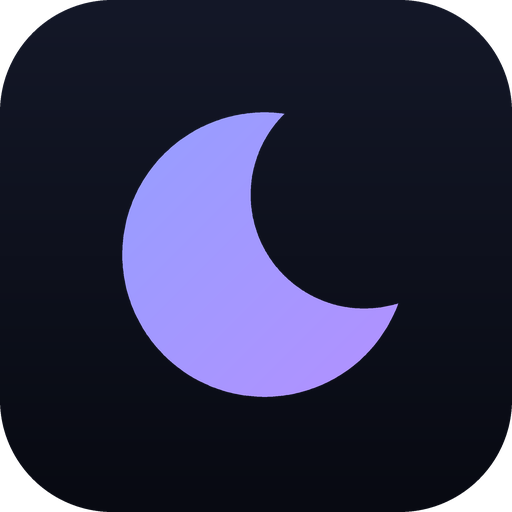

# Luna Browser

**A web browser built for the living-room TV — designed for the remote, readable from the sofa, smooth on weak TV hardware.**

[](https://github.com/newhalo/luna-browser/actions/workflows/build.yml)
[](https://github.com/newhalo/luna-browser/releases/latest)
[](LICENSE)
-3DDC84?logo=android&logoColor=white)


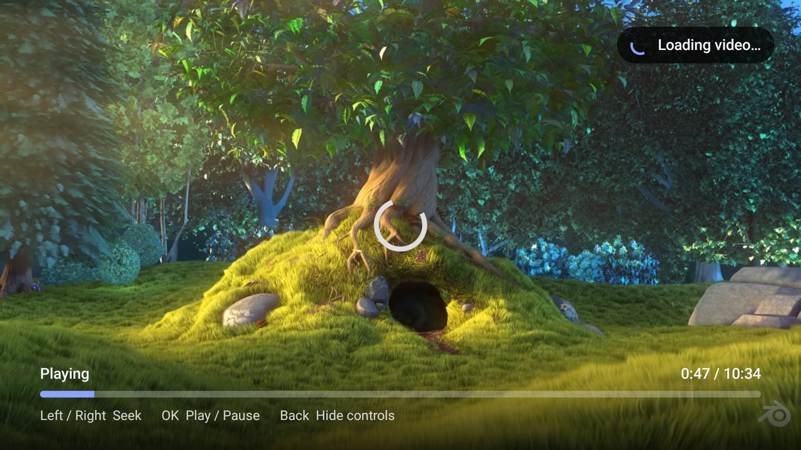

</div>

Most Android TV browsers are phone browsers stretched onto a big screen. Luna starts from the remote instead:
an on-screen pointer you steer with the D-pad, one-press access to everything, video controls made for
**Play / Pause / Left / Right**, a built-in ad and pop-up blocker, and a home screen that feels like a streaming app.

> **Status:** early (0.x) but daily-driven on a real TV. Latest release:
> [**v0.4.1**](https://github.com/newhalo/luna-browser/releases/latest) — tabs, per-site settings, a touchpad on the
> phone remote, video positions remembered outside fullscreen, and ad-block rules that update without a release.

## Features

- **Streaming-style home screen** — animated background, a backdrop that follows the focused card, 16:9 cards with
  real thumbnails of the videos and pages you opened, "continue watching" with progress bars, your most-used sites,
  favourites, clock and voice search.
- **Virtual cursor** — accelerates while you hold an arrow, hides itself when idle, scrolls at the screen edge,
  clicks with **OK**. Hold **OK** to switch to link-to-link focus navigation.
- **Video first** — fullscreen controls for any HTML5 video, **even inside a player iframe from another domain**
  (where most film sites put it). Hold ← / → to seek: key repeats accumulate, accelerate (10 s → 30 s → 60 s) and
  are previewed on the progress bar, then sent as **one** seek, so the stream doesn't reload at every step.
- **Continue where you left off** — videos of three minutes or more remember their position, whether you watch them
  fullscreen or inline on the page; open the page again (or pick it from Home) and Luna jumps back to where you
  stopped, and says so. Ads or another episode on the same page are never seeked.
- **Tabs** — up to 8 tabs with a switcher made of the same 16:9 cards as Home. Only the most recent few stay alive
  (two on low-end TVs); the rest are frozen to save memory and reload when you return. Tabs survive restarts.
- **Your layout** — thumbnail size (large / medium / small) for Home, and a History page that is a list or a grid.
- **Per-site settings** — the toolbar's *This site* button sets desktop mode, text size, ad blocking and pointer mode
  for one site only.
- **Your phone as a remote** — scan the QR code in *Settings → Phone remote* and your phone becomes a full remote
  (D-pad with hold-to-repeat, OK, Back, Home, Menu, media keys, volume), a **touchpad** (drag to move the pointer,
  two fingers to scroll, tap to click) and a keyboard for addresses, searches and text fields — no app to install, it
  is a web page served by the TV on your Wi-Fi (details [below](#phone-remote)).
- **Ad, tracker and pop-up blocking** — a standards-based filter engine (Adblock Plus / uBlock Origin syntax)
  with the community [EasyList](https://easylist.to) and [ABPVN](https://abpvn.com) lists refreshed daily, a built-in list, generic pop-up and
  redirect protection, removal of invisible click-catching overlays and "disable your ad blocker" nags.
  Details in [docs/ADBLOCK.md](docs/ADBLOCK.md).
- **Made for TV hardware** — 0.6 s cold start and ~55 fps on a 32-bit MediaTek TV SoC; see
  [docs/PERFORMANCE.md](docs/PERFORMANCE.md).
- **Remote-only UX** — every control reachable with the D-pad, visible focus, no touch-only UI, safe-area margins,
  large type, *Reduce motion* setting.
- Floating two-row toolbar (address; Back, Forward, Refresh, Home, Tabs, Save, pointer mode, This site, Settings), History, Favourites,
  clear error screens (offline, DNS, timeout, TLS), settings in seven plain-language groups.
- **Speaks your language** — English, Tiếng Việt, Español, Français, Deutsch, Português, Русский, 日本語, 한국어, 中文.
  Follows the TV's system language automatically; switch any time in Settings → General → Language.
- **Private by design** — no accounts, analytics or telemetry. See [Privacy](#privacy).

## Screenshots

> Captured on a Xiaomi TV S Pro 65" (4K, Android 14). Sample content is the open-source Blender movie
> *Big Buck Bunny* and Wikipedia.


| | |
|:--|:--|
| 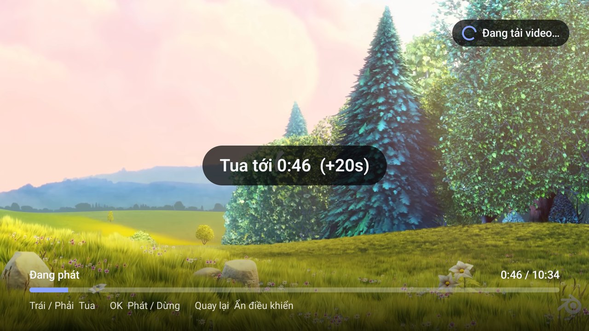 |  |
| **Hold → to seek:** target time and bar preview, one seek on release | **OK** shows controls; OK again plays / pauses |
| 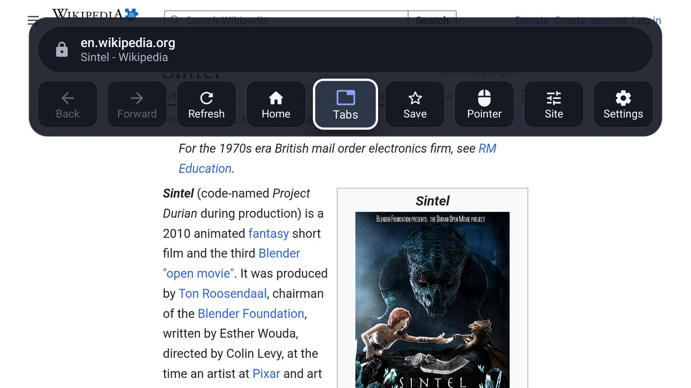 |  |
| **Menu** opens the floating toolbar | The on-screen pointer; **OK** clicks |
| 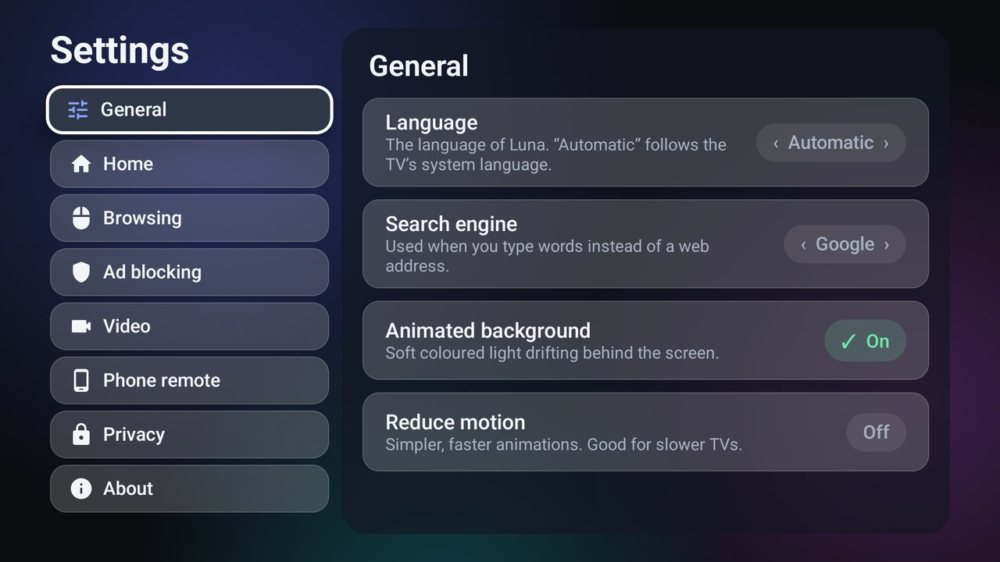 | 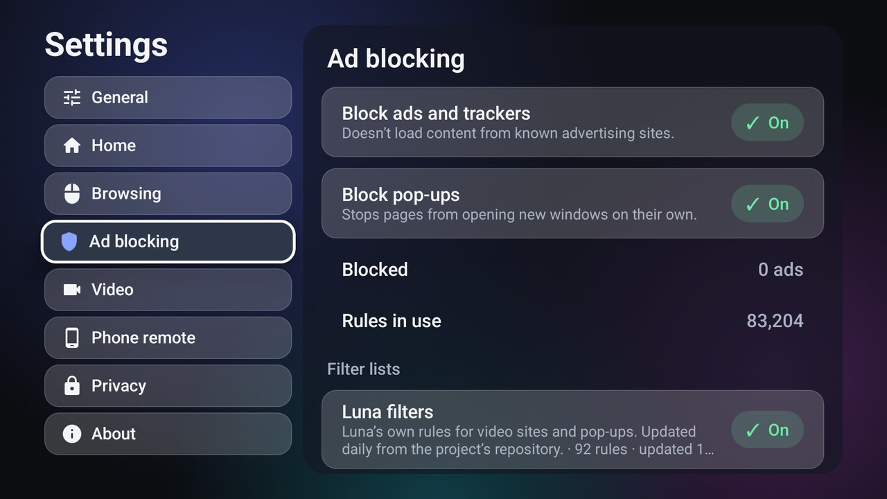 |
| Language picker (Automatic follows the TV), search engine, background | Filter lists with rule counts and update dates |
| 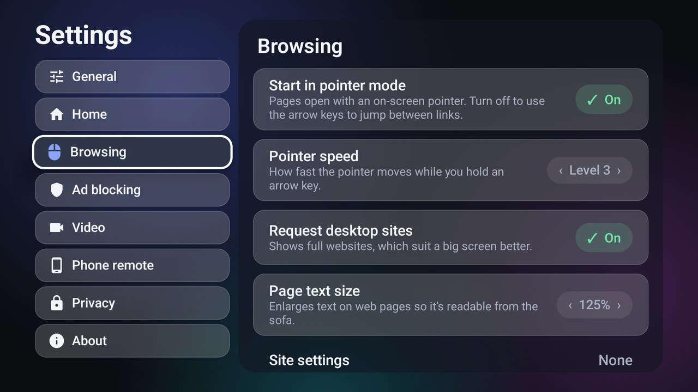 | 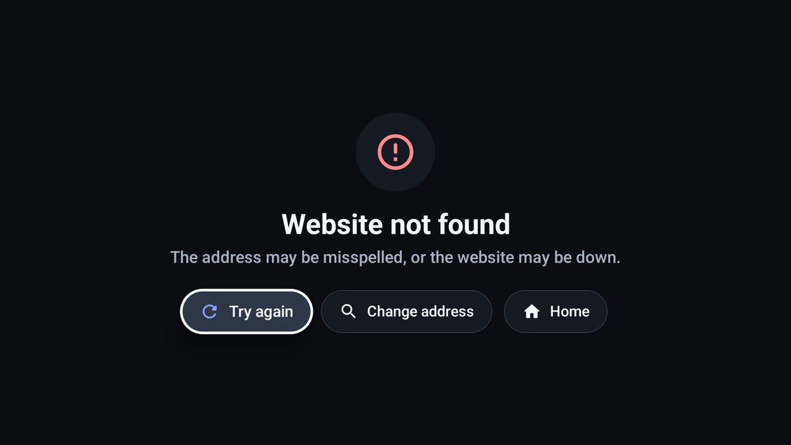 |
| Pointer speed, desktop sites, page text size | Clear errors with one-press recovery |
| 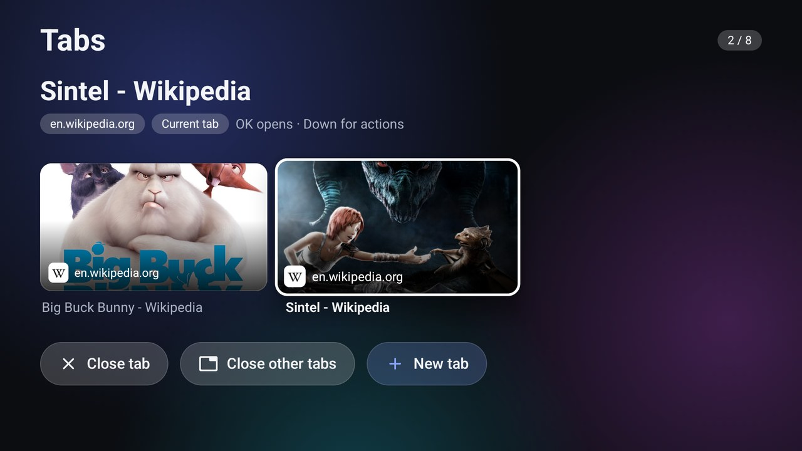 | 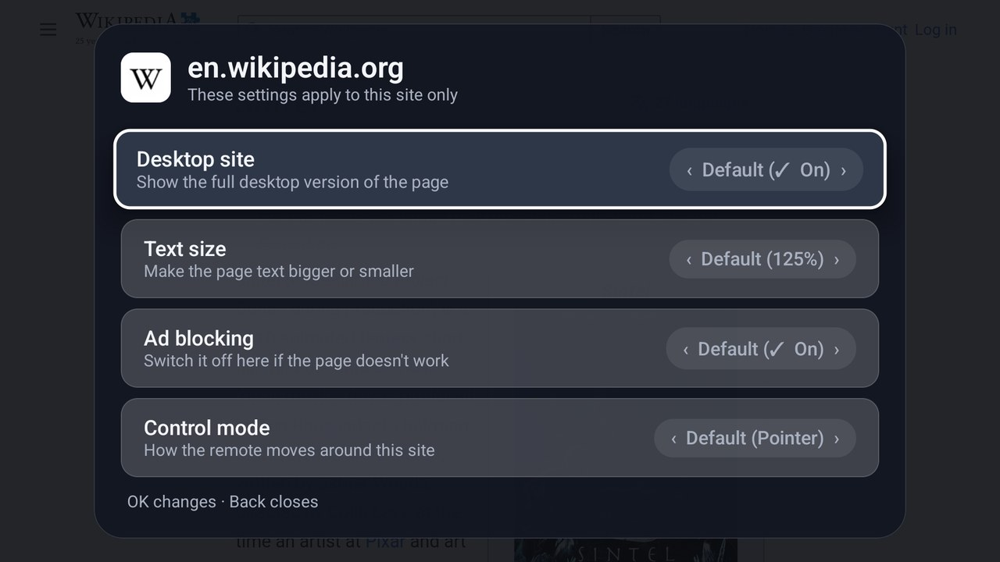 |
| **Tabs:** the same 16:9 cards as Home; **Down** for close / new tab | **Site** button: desktop mode, text size, ad blocking and pointer mode for one site only |
| 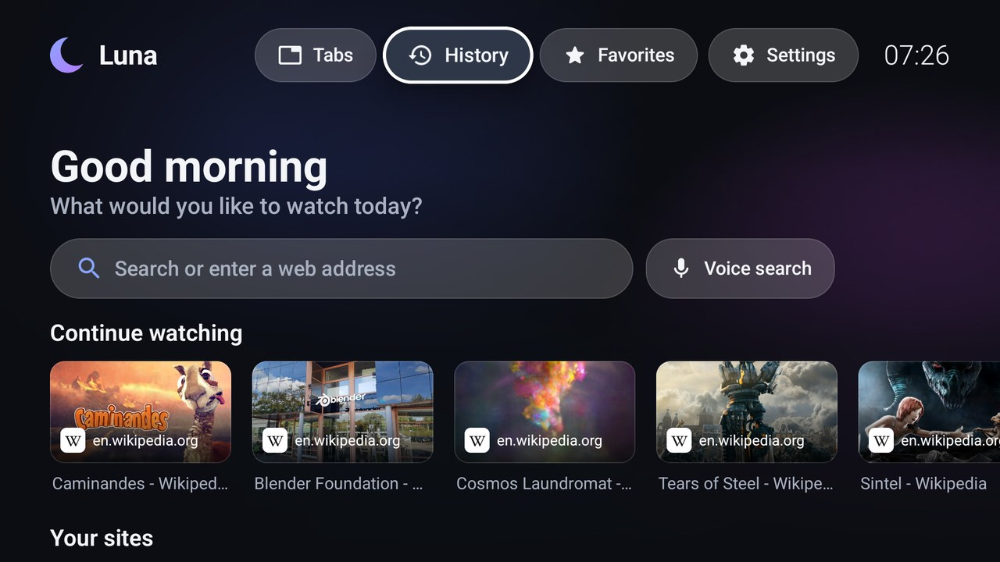 | 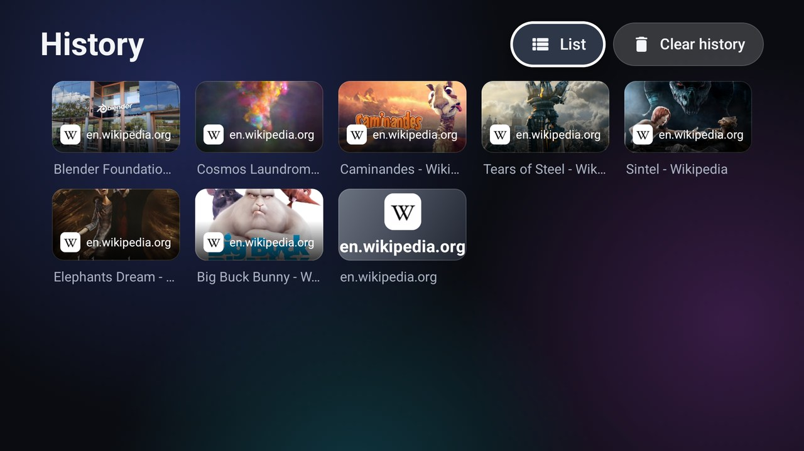 |
| **Thumbnail size** (Settings → Home): small tiles fit more on Home | **History** as a list or a grid, one button to switch |

### Your phone as a remote

Scan the QR code on the TV (*Settings → Phone remote*): the page opens already paired. **Remote** is the D-pad and keys
(switch it to **Touchpad** to steer the pointer by dragging), **Type** sends addresses, searches and text.


## Install

You need an **Android TV / Google TV** (Android 8.0+, API 26) and the ability to sideload an APK. One APK runs on
any CPU architecture and any TV resolution (720p to 4K); entry-level TVs get a lighter profile automatically.
Details and known limits: [docs/COMPATIBILITY.md](docs/COMPATIBILITY.md). Tested so far on a Xiaomi TV S Pro 65"
— reports from other TVs are welcome.

1. Download `luna-browser-vX.Y.Z.apk` from the [latest release](https://github.com/newhalo/luna-browser/releases/latest)
   (the page lists its SHA-256 checksum).
2. On the TV enable **Developer options → USB debugging / network debugging**
   (Settings → Device Preferences → About → press *Build* seven times).
3. From a computer on the same network:

   ```bash
   adb connect <tv-ip>:5555
   adb install -r luna-browser-vX.Y.Z.apk
   ```

   Accept the *Allow USB debugging?* prompt on the TV the first time. Without a computer you can use a
   "send files to TV" app and a file manager instead.

Luna appears in the TV launcher as **Luna Browser**. Updating is the same `adb install -r` with the newer APK; your
history and favourites are kept.

> **Switching between release and source builds:** official releases are signed with the project's private key, builds
> from source with the public development key, and Android won't install one over the other — uninstall first
> (`adb uninstall com.luna.browser`; this clears Luna's data).

## Controls

| Key | On a web page | In fullscreen video |
|---|---|---|
| D-pad | move the pointer; at the screen edge scroll; **Up** at the very top opens the toolbar | **← / →** seek (hold to accelerate) |
| **OK** | click | show controls, then play / pause |
| Hold **OK** | switch pointer ⇄ link-focus mode | — |
| **Menu** (or **Info**) | show / hide the toolbar | same |
| **Back** | close toolbar → previous page → Home → exit | hide controls → leave fullscreen |
| Hold **Back** | open the toolbar (use this if your remote has no Menu key) | leave fullscreen, open toolbar |
| Play/Pause, ⏪ ⏩ | control the page's video | same |

Home, volume and power keys are never intercepted. Full table: [docs/DESIGN.md](docs/DESIGN.md#remote-map).
No Menu key, or want to type faster? Use [your phone as the remote](#phone-remote).

## Build from source

Requirements: **JDK 17** and the **Android SDK** (platform 34) — Android Studio sets up both.

```bash
git clone https://github.com/newhalo/luna-browser.git
cd luna-browser
./gradlew :app:testDebugUnitTest :app:assembleDebug     # gradlew.bat on Windows
adb install -r app/build/outputs/apk/debug/app-debug.apk
```

Use `:app:assembleRelease` for the optimised build (R8 + baseline profiles) — that is the one to run on a TV.
Debug and release builds are signed with the same public development key, so they install over each other.
Official releases use a private key (so uninstall before switching between the two); see
[docs/RELEASING.md](docs/RELEASING.md).

## Project layout

```
app/src/main/java/com/luna/browser/
  MainActivity.kt, AppState.kt        entry point, navigation, global key handling, language
  browser/                            WebView controller (cursor, video, popups), PopupGuard
  data/                               Store (settings, history), AdBlocker, filter/ (list parser + engine), Resume (video positions)
  remote/                             PhoneRemote: the LAN web server + page behind "your phone as a remote"
  ui/                                 Compose screens, TV components, theme
app/src/main/res/values*/strings.xml  UI strings: English default + 9 translations
app/src/main/assets/filters/luna.txt  Luna's own filter rules (Adblock Plus syntax)
app/src/test/                         unit tests (filter engine, localisation, device compatibility, resume rules, phone remote)
tools/sitecheck/                      on-TV ad-blocking report (Chrome DevTools + adb)
tools/perf/                           on-TV frame timing
docs/                                 architecture, design, ad blocking, performance, localization, compatibility, releasing
```

Start with [docs/ARCHITECTURE.md](docs/ARCHITECTURE.md).

## Phone remote

Typing with a TV remote is slow, and not every remote has a Menu key. With *Settings → Phone remote* on (the default),
Luna listens on your home network while it is on screen:

1. On the TV open **Settings → Phone remote**: it shows a QR code, the address (such as `http://192.168.1.20:8765`)
   and a 6-digit PIN.
2. On a phone connected to the same Wi-Fi, scan the QR code with the camera: the page opens already paired (or open the
   address by hand and enter the PIN once). The phone remembers the pairing.
3. The **Remote** tab is a full remote in your hand: D-pad (hold an arrow to keep the pointer moving), **OK**, Back,
   Home, Menu, rewind / play-pause / fast-forward and volume. The **Type** tab sends text: type an address or words and
   tap **Open on TV** or **Search on TV**; to fill a text box on a page (a film site's search, a login) put the pointer
   on the box, press OK, then tap **Type into the page** (or **Type and press Enter**).

Several phones can be paired and used at the same time; they share the PIN, and wrong guesses are counted per phone,
so one stale page can't lock the others out.

**Safety.** Every request needs the PIN; five wrong PINs lock that phone for 30 seconds; it only opens web pages,
searches, presses the remote keys inside Luna, changes the volume and types into the focused field; and it stops
listening when Luna is not on screen. The traffic is plain HTTP on your local network, so turn it off (the same
settings page) on networks you don't trust. *New PIN* unpairs all phones. Details: [SECURITY.md](SECURITY.md).

## Privacy

Luna has no accounts, no analytics and no telemetry. The only network traffic besides the pages you open:

| Request | When | Why |
|---|---|---|
| Filter lists: EasyList (`easylist.to`) or, for Vietnamese, ABPVN (`raw.githubusercontent.com`, `abpvn.com`), plus Luna's own `luna.txt` from this repository (`raw.githubusercontent.com`) | first run, then daily | ad-blocking rules (each list can be switched off in Settings) |
| `google.com/s2/favicons` | home screen, only for the built-in quick sites | their icons |
| Thumbnails (`i.ytimg.com` or the page's own `og:image`) | home / history cards | artwork for pages you visited |
| Incoming: your phone → the TV on port 8765 (LAN only, PIN-protected) | only while Luna is on screen and *Phone remote* is on | the phone remote |

History, favourites and thumbnails stay in the app's private storage on the TV; *Settings → Privacy* clears them.
Pages are rendered by the Android System WebView and get **no** JavaScript bridge to the app.

## Roadmap

**Next**
- [ ] Native-speaker review of the translations, then more languages ([how](docs/LOCALIZATION.md)).
- [ ] Compatibility reports from more TVs and Android versions ([how](docs/COMPATIBILITY.md#reporting-a-device)).
- [ ] Tab thumbnails that update live (today a card shows the page's last saved thumbnail).

**Later**
- [ ] Profiles: separate history and favourites per family member.
- [ ] Emulator-based UI tests for D-pad navigation.
- [ ] Gradle 9 and the newest Compose, once the plugins catch up.

**Done in 0.4.0:** tabs, per-site settings, phone touchpad, inline video positions, filter-rule updates without a
release, and the toolchain upgrade (Android Gradle Plugin 8.13, Gradle 8.14, Kotlin 2.1, Compose BOM 2024.12).

**Not planned**
- A download manager: a TV browser is for watching; use a phone or computer for files.
- DRM streaming services (Netflix, Disney+, …): a WebView can't provide the hardware DRM they need; use their own apps.

Ideas and bug reports are welcome — see [CONTRIBUTING.md](CONTRIBUTING.md).

## Contributing

Pull requests are welcome. Please read [CONTRIBUTING.md](CONTRIBUTING.md) and the
[Code of Conduct](CODE_OF_CONDUCT.md) first. Found a site that still shows ads? Use the *Ad / pop-up report*
issue template — it is usually a one-line fix. For vulnerabilities see [SECURITY.md](SECURITY.md).

## Acknowledgements

[EasyList](https://easylist.to) and [ABPVN](https://abpvn.com) for the filter lists · [Jetpack Compose](https://developer.android.com/jetpack/compose) ·
[Coil](https://coil-kt.github.io/coil/) · the Chromium / Android WebView team · the Blender Foundation for open
movies that make great test footage. Full list: [THIRD_PARTY_NOTICES.md](THIRD_PARTY_NOTICES.md).

## Disclaimer

Luna is a general-purpose browser. It does not host, index or distribute any content, and the ad blocker exists to
protect viewers from intrusive ads, trackers and malicious pop-ups. You are responsible for complying with the laws
and terms of service that apply to the sites you visit.

## License

[MIT](LICENSE) © 2026 Nguyen Anh Luan
